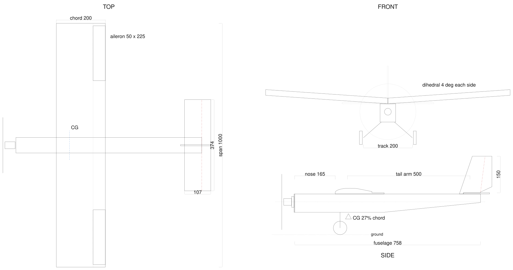

# Self-designed RC trainer plane

A 1000 mm electric high-wing trainer designed from first principles: every key
dimension is calculated, not copied from a kit. Foam board for the airframe,
3D-printed parts where strength or accuracy matters.

**Student:** Arslan Xajiyev (grade 9). The original brief is in [`rc-plane-project.md`](rc-plane-project.md).


> **Read [`docs/RULES_AND_SOURCING.md`](docs/RULES_AND_SOURCING.md) before buying any motor, ESC or radio.**
> Uzbekistan restricts unmanned aircraft and their components. Model aircraft are treated
> differently from drones, but only under conditions. The half-scale test glider needs no electronics at all.

## The design in numbers

Defaults from `params.py`; the full derivation is in [`sizing/report.md`](sizing/report.md).

| | |
|---|---|
| Layout | High wing, conventional tail, tractor motor, 4 channels |
| Wingspan / chord | 1000 mm / 200 mm (area 20 dm², aspect ratio 5) |
| Airfoil | Clark Y, flat bottom, folded foam board, 11.7% thick |
| Dihedral | 4° each side |
| Fuselage | 758 mm long, 64 x 75 mm box |
| Tail | Stabilizer 374 x 107 mm (V_h = 0.50), fin 150 mm high (V_v = 0.040) |
| All-up weight | 783 g (budget, with 500 g/m² foam board) |
| Wing loading | 39 g/dm² |
| Stall speed | 7.9 m/s at Tashkent's elevation, 25 °C |
| CG | 27% chord = 54 mm behind the leading edge (25% for the first flight) |
| Static margin | 14.6% (hand estimate, to be confirmed in XFLR5) |
| Power | 2212 1000 KV, 9x4.7 prop, 3S 1500 mAh, 30 A ESC: about 144 W, 184 W/kg |
| Thrust-to-weight | 0.87 |
| Flight time | about 11 minutes |



## How the design is derived

1. **Wing** — span and chord are inputs. Area and wing loading give the stall speed
   `V = sqrt(2W / (ρ S CLmax))`, using the air density at the flying site.
2. **Tail** — the tail arm is 2.5 chords. Tail areas come from the volume coefficients:
   `S_h = V_h S c / L_t` and `S_v = V_v S b / L_t`.
3. **Weight** — every component is listed with its mass and position. Foam parts are
   weighed by area, so the budget follows the geometry.
4. **Balance** — the nose length is not guessed. The calculator finds the length at which
   the battery sits in the middle of its bay with the CG on target, so it can still be moved either way.
5. **Stability** — the neutral point is estimated from the tail volume, lift slopes and downwash,
   and the static margin is checked against 10–15%.
6. **Power** — power loading, thrust-to-weight and pitch speed are checked against trainer guidelines.

## Rebuild everything

```bash
pip install -r requirements.txt
```

```bash
python build.py
```

Change any input in `params.py` (for example `WINGSPAN = 1200`) and run `build.py` again.
The report, the templates, the STL files and the drawings are all regenerated, and the
script prints a warning if a target is missed. `python build.py --fast` skips the 3D parts.

## What is in the repository

```
params.py                 all inputs
build.py                  runs everything
sizing/design_calc.py     the calculator
sizing/report.md          sizing report (generated)
sizing/design.json        every derived dimension (generated, read by the CAD scripts)
cad/airfoil.py            Clark Y and the foam section that is actually built
cad/wing.py fuselage.py tail.py glider.py   foam templates + 3D solids
cad/printed_parts.py      3D-printed parts (CadQuery)
cad/assembly.py           full 3D model
cad/export_templates.py   SVG + tiled A4 PDF export
templates/                1:1 foam templates, cut list
stl/                      printable parts, print list
analysis/                 Clark Y .dat file and XFLR5 notes
docs/                     build guide, rules and sourcing, drawings, 3D model (STEP)
```

## Build it

1. [`docs/RULES_AND_SOURCING.md`](docs/RULES_AND_SOURCING.md) — what is allowed, and what to buy.
2. [`templates/CUT_LIST.md`](templates/CUT_LIST.md) — every foam part.
3. [`stl/PRINT_LIST.md`](stl/PRINT_LIST.md) — every printed part.
4. [`docs/BUILD_GUIDE.md`](docs/BUILD_GUIDE.md) — step by step, from the test glider to the first flight.
5. [`analysis/xflr5_notes.md`](analysis/xflr5_notes.md) — the stability check.

## Acceptance checklist

- [x] Changing `params.py` and rerunning updates every dimension, template and STL
- [x] The sizing report shows wing loading, stall speed, tail volumes and CG position
- [x] Weight budget is within target (783 g of 700–900 g)
- [ ] XFLR5 confirms a static margin of 10–15% (hand estimate: 14.6%; inputs are ready in `analysis/`)
- [x] All printed parts fit the 220 x 220 mm printer bed
- [x] 1:1 templates are tiled on A4 with overlap, alignment marks and a 50 mm check square
- [ ] A4 templates checked on paper (measure the 50 mm square after printing)
- [ ] Half-scale glider glides straight and level
- [ ] Full plane completes a controlled flight
- [ ] Build photos and flight log added below

## Flight log

| Date | Flight | Battery used (mAh) | Time (min) | Wind | What happened | What to change |
|---|---|---|---|---|---|---|
| | | | | | | |
