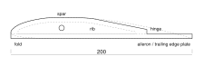

# Build guide

Sizes below are the defaults. If you change `params.py`, use the numbers in
`sizing/report.md` and `templates/CUT_LIST.md`.

Tools: sharp craft knife and spare blades, steel ruler, cutting mat or cardboard,
hot glue gun, packing tape, pencil, sanding block, small screwdrivers, pliers.

## Before you start

1. Read [`RULES_AND_SOURCING.md`](RULES_AND_SOURCING.md).
2. Weigh a sheet of your foam board, set `FOAM_AREAL_DENSITY`, run `python build.py`.
3. Print `templates/pdf/*.pdf` at **100%, no "fit to page"**. Measure the green 50 mm square on
   every sheet. Trim along the dashed frame, overlap the sheets so the corner crosses line up, and tape.

**Line types:** solid = cut through · long blue dashes = score and fold ·
red dash-dot = hinge (cut halfway, then bevel) · thin grey dots = mark with a pencil only.

**Cutting foam board:** three light passes with a sharp blade beat one heavy pass.
Change the blade when it starts to tear the foam.

## Step 1 — Half-scale test glider (one evening, no electronics)

Template: `glider_half_scale`.

1. Cut the wing, fuselage profile, stabilizer and fin from 5 mm foam.
2. Crease the wing along the centre line and prop each tip up 18 mm. Run hot glue into the crease.
3. Glue the wing and stabilizer flat on the top edge of the fuselage at the marks. Glue the fin upright on the stabilizer centre line.
4. Tape coins or clay on the nose until the glider balances on two fingertips at the **balance mark** on the wing.
5. Throw it gently, level, over grass.
   - Dives: remove a little nose weight.
   - Climbs, stalls, drops: add nose weight.
   - Turns: check that the fin is straight and both wing tips are raised equally.
6. A long, straight, steady glide means the tail size and CG position work. Now build the real one.

## Step 2 — Wing halves (make two, mirror images)

Template: `wing_half`, `wing_ribs`. Each half is one piece, 500 x 363 mm.

1. Cut the skin rectangle. Mark all lines on the **inside** face. For the second half, flip the template over.
2. Cut the servo pocket and the servo lead hole.
3. Score the two leading-edge fold lines and the crease lines: cut through the paper and about half the foam, never the outer paper.
4. Cut the aileron free at its two ends, then score the hinge line. Fold the aileron back and slice a 45° bevel so it can swing up and down. Run a strip of packing tape along the outside of the hinge.
5. Cut 4 standard ribs and 1 root rib (two pieces) per half. Trace the rib template onto card first so every rib is identical.
6. Glue the ribs upright on the bottom plate at their marks, with the spar threaded through the holes. The spar stops 5 mm short of the tip. Leave the root rib gap open.
7. Dry-fit: fold the top skin over the ribs. It should land on the bottom plate along the hinge line. Trim if it overhangs.
8. Glue: a bead of hot glue on every rib top and along the landing line, fold over, and hold flat on the table under a ruler for a minute. Keep the bottom plate flat so the wing has no twist.
9. Tape the leading edge.

## Step 3 — Join the wing

Printed part: `wing_joiner`.

1. Push the joiner arms onto the two spar ends inside the root rib gaps. The V points down, so the tips rise.
2. Put one half flat on the table. The other tip must sit **70 mm** above the table (2 x 35 mm).
3. Sand the root faces so they meet without a gap, then glue: joiner, root faces, and a strip of tape over the top and bottom of the joint.
4. Leave the wing locators until the fuselage is built (step 4.9).

## Step 4 — Fuselage

Templates: `fuselage_shell`, `fuselage_bottom_hatch`, `small_parts`.

1. Cut the shell outline, the wing bay, the four dowel holes and the two pushrod slots.
2. **B-folds:** along each pair of dashed lines, cut through the paper and foam (not the outer paper) and peel out the 5 mm strip of foam between them.
3. Mark former, shelf rail, CG and wing positions on the inside.
4. Glue the two shelf rails along their marks, then fold the sides down 90° with glue in the channels. Check that the box is square.
5. Glue in the battery shelf (on the rails), former 1 at the wing trailing edge and former 2 halfway down the tail.
6. Glue the servo tray across the fuselage 275 mm from the nose, 25 mm below the top edge, so the servo arms clear the wing.
7. Crease the bottom strip at the taper line and glue it on. Before closing, glue the gear plate inside the floor at the gear mark.
8. Glue the firewall into the nose: lip inside the foam, wire slot at the bottom.
9. Glue a dowel plate over each dowel hole and push the two 6 mm dowels through; they stick out 14 mm each side. Fit the wing locators into the bay opening and glue them to the wing underside so the wing always sits in the same place.
10. Hatch: tape hinge along one long edge, a tape tab or a small magnet on the other.

## Step 5 — Tail

Template: `tail`.

1. Cut the stabilizer and fin. Score and bevel the hinges like the ailerons, tape the outside.
2. Glue the stabilizer on top of the fuselage, hinge line exactly at the fuselage end, square to the fuselage. Measure from each stabilizer tip to the same wing tip: the two distances must match.
3. Glue the fin on the centre line. The small step at its front sits on the fuselage top. Check it is vertical with a set square.
4. The rudder bottom is cut on a slant so the elevator can rise under it.

## Step 6 — Power and radio

Printed parts: `motor_mount`, `servo_cradle_wing_*`, `control_horn`, `gear_block`, `wheel`.

**No propeller on the motor until step 7.6.**

1. Screw the motor to the mount from behind with four M3x8 screws (heads in the counterbores). The screws must go no more than 3 mm into the motor, or they touch the windings.
2. Bolt the mount to the firewall with four M3x25 screws, nuts inside. **The notch is the top. The thick side is on the pilot's left.** That gives 2.5° right thrust and 1.5° down thrust.
3. ESC on the floor under the battery shelf, motor wires through the firewall slot.
4. Centre every servo with the radio on before fitting its arm.
5. Aileron servos: screw each servo into its cradle, tape or glue the cradle over the wing pocket with the arm through the slot. Run the leads through the rib holes to the centre hole.
6. Elevator and rudder servos into the fuselage tray.
7. Glue the horns: aileron horns on the underside in line with the servo arms, elevator horn on the underside, rudder horn on the right side. The front edge of each horn sits on the hinge line.
8. Pushrods: Z-bend at the servo end, measure with the surface at neutral, Z-bend at the horn end. Elevator and rudder rods leave through the side slots.
9. Landing gear: bend the wire (54 mm flat, two 97 mm legs, two 25 mm axles), clamp it in the groove of the gear block and bolt the block through the floor into the gear plate. Wheels with a collar each side. Add a skewer tail skid.
10. Receiver on velcro behind the servo tray. Battery on velcro on the shelf.

## Step 7 — Setting up

1. **Balance.** Fully assembled, battery in, propeller off. Lift the plane on two fingertips under the wing, **50 mm behind the leading edge** for the first flight (design CG is 54 mm). Slide the battery until it sits level or slightly nose-down. Mark the battery position.
2. **Control directions.** Stand behind the plane.
   - Right stick right: right aileron up, left aileron down.
   - Right stick back: elevator up.
   - Left stick right: rudder right.
   - Reversed controls are the most common first-flight crash. Check twice.
3. **Throws** at the trailing edge: ailerons ±10 mm, elevator ±8 mm, rudder ±15 mm.
4. **Failsafe:** set the receiver to cut the throttle when the signal is lost.
5. **Range check** with a helper, following your radio's manual.
6. Fit the propeller, numbers facing forward. Hold the plane and run the motor up briefly: nothing should shake loose.

## Step 8 — First flight

- Calm morning, wind under 3 m/s, a big open field, grass, an adult present.
- If at all possible, let an experienced RC pilot make the first flight and trim it.
- Take off or hand-launch into the wind at about 3/4 throttle, wings level, straight ahead. Climb gently.
- Fly three mistakes high. Trim for level flight at half throttle.
- Land with the battery still fresh: 6 minutes for the first flights.
- Write the flight in the log in the README: battery used, time, what happened, what to change.

## Safety

- **Propeller:** never work on the plane with the battery connected and the propeller fitted.
- **LiPo:** balance charger only, in a LiPo bag, never unattended, never a puffed or damaged pack.
- **Site:** away from people, roads, buildings and power lines, and only where model flying is allowed.
